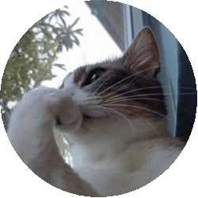
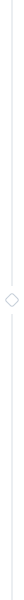

<strong>مرحبًا 👋، أنا</strong>

<h3> Djam Deen</h3>

💻&nbsp;مطوّر&nbsp;باك&nbsp;إند&nbsp;&nbsp;&nbsp;&middot;&nbsp;&nbsp;&nbsp;🤖&nbsp;بانٍ&nbsp;منتجات&nbsp;بالذكاء&nbsp;الاصطناعي&nbsp;&nbsp;&nbsp;&middot;&nbsp;&nbsp;&nbsp;⚽&nbsp;مشجّع&nbsp;برشلونة&nbsp;&nbsp;&nbsp;&middot;&nbsp;&nbsp;&nbsp;🐱&nbsp;محبّ&nbsp;للقطط

&nbsp;&nbsp;
&nbsp;&nbsp;
&nbsp;&nbsp;
&nbsp;&nbsp;

[`en` English](README.md) · [`fr` Français](README.fr.md) · [`es` Español](README.es.md) · **العربية** · [`pt` Português](README.pt.md) · [`zh` 简体中文](README.zh.md) · [`ja` 日本語](README.ja.md) · [`ru` Русский](README.ru.md)

أنا **Djamal ALIDOU M.**، لكن يمكنك ببساطة أن تناديني **Djam Deen**. أنا من بنين وأعيش في كوتونو.

متخصص في تطوير الباك إند، وأحرص على أن تعمل التطبيقات والمواقع وواجهات API فعلاً، وأن تصمد وأن تكون آمنة — وليس فقط أن تكون جميلة. وخلافًا للصورة النمطية عن مطوّري الباك إند، أعرف أيضًا كيف أصنع أشياء أنيقة جدًا على مستوى التصميم 😏.

أنا أيضًا شغوف بريادة الأعمال والذكاء الاصطناعي، وأستخدمهما يوميًا في عملي.

يدور عملي أساسًا حول منتجاتي الخاصة ومشاريع المصدر المفتوح، وأحيانًا منتجات لأفراد.

أنا لا أبني لمجرد البناء: أبني حلولاً لمشاكل حقيقية.

## حاليًا

**ما أعمل عليه الآن.**

<table>
<tr>
<td width="44%" valign="top">
  
</td>
<td width="56%" valign="top">

المشروع الحالي · <code>قيد العمل</code>

### AgentMob

تطبيق جوّال يتيح لك توجيه وكلاء الذكاء الاصطناعي في سطر الأوامر والموافقة على طلباتهم من هاتفك أثناء عملهم على حاسوبك.

- **الجوال** — PWA قابلة للتثبيت
- **الحاسوب** — خادم npm محلي + SQLite
- **الرابط** — زمن حقيقي مشفّر
- **الإشارات** — لا يرى المحتوى أبدًا

[عرض AgentMob على الإنترنت](https://agentmob.djamdeen.com) · [الكود المصدري](https://github.com/djamdeen10/agentmob-local-server) · [مزيد من التفاصيل](https://djamdeen.com/ar/projet/agentmob)

</td>
</tr>
</table>

## المشاريع

**ما أقضي ليالي فيه.**

AgentMob هو المشروع الذي يأخذ معظم ليالي حاليًا. والباقي — نماذج أولية ليلية وأدوات صغيرة وتجارب مفتوحة المصدر — يعيش على GitHub.

[عرض كل المستودعات](https://github.com/djamdeen10?tab=repositories) · [صفحة المشاريع](https://djamdeen.com/ar/projet)

## بعض الأرقام

  
  

## التقنيات

**تُختار حسب المشكلة، لا العكس.**

<table>
<tr>
<td width="47%" valign="top">

**اللغات** 
     

**الخلفية و API** 
   

**الذكاء الاصطناعي** 
 

</td>
<td width="6%" align="center" valign="middle"></td>
<td width="47%" valign="top">

**الواجهة** 
  

**البيانات** 
 

**الأدوات والبنية التحتية** 
   

</td>
</tr>
</table>

## خارج الكود

<table>
<tr>
<td width="50%" valign="top">

**🎧 الموسيقى** <code>Rap / Drill / Pop</code>

دائمًا بسماعات على أذني. الراب والدرِل للإيقاع، وقليل من البوب للتنويع.

</td>
<td width="50%" valign="top">

**⚽ كرة القدم** <code>FC Barcelona</code>

برشلوني في القلب. ارتباط حقيقي باللعب الجماعي والرؤية وثقافة التقدّم في النادي.

</td>
</tr>
<tr>
<td width="50%" valign="top">

**🐱 القطط** <code>محبّ القطط 🐾</code>

عاشق مطلق للقطط. هي التي تحكم في البيت، ونحبّها هكذا.

</td>
<td width="50%" valign="top">

**🚀 العقلية** <code>تحفيز</code>

شعاري: «احلم كبيرًا واعمل أكبر». مستعد دائمًا لخوض تحديات جديدة.

</td>
</tr>
<tr>
<td width="50%" valign="top">

**📺 المسلسلات** <code>تفكير واستراتيجية</code>

معجب كبير بالمسلسلات التي تُبقي العقل مشتعلًا. أحب الحبكات المعقّدة والاستراتيجيات المحكمة والخطط الدقيقة جدًا. من Mentalist إلى Casa de Papel مرورًا بـScorpion وThe Blacklist، أحب عندما تُحاك خطط جنونية وتُحل ألغاز معقّدة ويُقلب عقلك حتى الدقيقة الأخيرة.

</td>
<td width="50%" valign="top">

**🤝 مهارة شخصية** <code>العمل الجماعي</code>

أحب التعاون والتقدّم معًا. بالنسبة لي، أفضل الأفكار وأفضل المشاريع تُبنى ضمن فريق.

</td>
</tr>
</table>

## فكرة، مشروع، سؤال؟

أنا دائمًا مستعد للحديث عنه. الأسهل أن تراسلني.

&nbsp;
&nbsp;
&nbsp;
&nbsp;

  <em>«الأشخاص المجنونون بما يكفي ليعتقدوا أنهم يستطيعون تغيير العالم هم الذين يغيّرونه فعلًا.»</em> 
  — Steve Jobs

[djamdeen.com](https://djamdeen.com/ar) · صُنع بـ ❤️ في كوتونو

