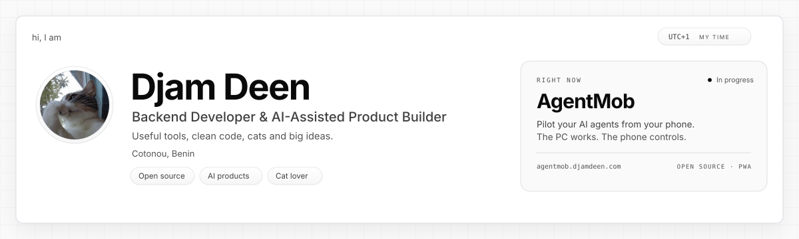

  <picture>
    <source media="(prefers-color-scheme: dark)" srcset="assets/banner-dark.svg">
    <source media="(prefers-color-scheme: light)" srcset="assets/banner-light.svg">
    
  </picture>

  
  
  
  
  

[`en` English](README.md) · [`fr` Français](README.fr.md) · **Español** · [`ar` العربية](README.ar.md) · [`pt` Português](README.pt.md) · [`zh` 简体中文](README.zh.md) · [`ja` 日本語](README.ja.md) · [`ru` Русский](README.ru.md)

## Hola 👋 — Djam Deen

**Desarrollador backend y creador de productos con IA** · Cotonú, Benín

Me llamo **Djamal ALIDOU M.**, pero puedes llamarme simplemente **Djam Deen**. Soy originario de Benín y vivo en Cotonú.

Especializado en desarrollo backend, me aseguro de que las apps, los sitios y las APIs funcionen de verdad, aguanten y sean seguros, no solo de que sean bonitos. Y, en contra de los tópicos sobre los devs backend, también sé hacer cosas muy limpias en el diseño 😏.

También me apasionan el emprendimiento y la IA, que uso a diario en mi trabajo.

Mi trabajo gira principalmente en torno a mis propios productos, proyectos de código abierto y, a veces, productos para particulares.

No construyo por construir: construyo soluciones para problemas reales.

## Ahora mismo

**En lo que estoy trabajando actualmente.**

<table>
<tr>
<td width="44%" valign="top">
  
</td>
<td width="56%" valign="top">

PROYECTO ACTUAL · <code>En curso</code>

### AgentMob

Una aplicación móvil que permite pilotar y autorizar a tus agentes de IA de línea de comandos desde el teléfono mientras trabajan en tu ordenador.

- **Móvil** — PWA instalable
- **PC** — servidor local npm + SQLite
- **Enlace** — tiempo real cifrado
- **Señalización** — nunca ve el contenido

[Ver AgentMob en línea](https://agentmob.djamdeen.com) · [Código fuente](https://github.com/djamdeen10/agentmob-local-server) · [Más detalles](https://djamdeen.com/es/projet/agentmob)

</td>
</tr>
</table>

## Proyectos

**En lo que paso mis noches.**

AgentMob es el proyecto que se lleva la mayoría de mis noches ahora mismo. El resto — prototipos nocturnos, pequeñas herramientas y experimentos de código abierto — vive en GitHub.

[Ver todos los repositorios](https://github.com/djamdeen10?tab=repositories) · [Página de proyectos](https://djamdeen.com/es/projet)

## Algunos números

  
  

## Stack

**Elegida según el problema, no al revés.**

**Lenguajes** 
     

**Frontend** 
  

**Backend y API** 
   

**Datos** 
 

**IA** 
 

**Herramientas e infraestructura** 
   

## Fuera del código

<table>
<tr>
<td width="50%" valign="top">

**🎧 Música** <code>Rap / Drill / Pop</code>

Siempre con auriculares. Rap y drill por el ritmo, y un poco de pop para variar.

</td>
<td width="50%" valign="top">

**⚽ Fútbol** <code>FC Barcelona</code>

Barcelonista de corazón. Un apego real al juego colectivo, a la visión y a la cultura de progreso del club.

</td>
</tr>
<tr>
<td width="50%" valign="top">

**🐱 Gatos** <code>Amante de los gatos 🐾</code>

Absolutamente enamorado de los gatos. Mandan en casa, y nos gustan así.

</td>
<td width="50%" valign="top">

**🚀 Mentalidad** <code>Motivación</code>

Mi lema: «Sueña en grande y trabaja aún más grande». Siempre dispuesto a aceptar nuevos retos.

</td>
</tr>
<tr>
<td width="50%" valign="top">

**📺 Series** <code>Reflexión y estrategia</code>

Gran fan de las series que te obligan a mantener el cerebro encendido. Me encantan las tramas complejas, las estrategias bien engrasadas y los planes milimétricos. De El Mentalista a La Casa de Papel, pasando por Scorpion y The Blacklist, me gusta cuando se elaboran planes increíbles, se resuelven enigmas complejos y te dan la vuelta a la cabeza hasta el último minuto.

</td>
<td width="50%" valign="top">

**🤝 Habilidad interpersonal** <code>Trabajo en equipo</code>

Me encanta colaborar y avanzar juntos. Para mí, las mejores ideas y los mejores proyectos se construyen en equipo.

</td>
</tr>
</table>

## ¿Una idea, un proyecto, una pregunta?

Siempre estoy dispuesto a hablarlo. Lo más fácil es que me escribas.

  <a href="mailto:djamdeen10@gmail.com">Escríbeme</a> · <a href="https://djamdeen.com/es">djamdeen.com</a> · <a href="https://github.com/djamdeen10">GitHub</a> · <a href="https://x.com/djamdeen10">X</a>

  <em>«Solo quienes están lo bastante locos para pensar que pueden cambiar el mundo lo consiguen»</em> 
  — Steve Jobs

[djamdeen.com](https://djamdeen.com/es) · Hecho con ❤️ en Cotonú

