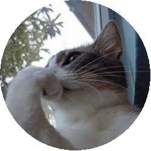
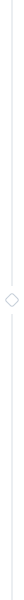

<strong>Salut 👋, je suis</strong>

<h3> Djam Deen</h3>

💻&nbsp;Développeur&nbsp;backend&nbsp;&nbsp;&nbsp;&middot;&nbsp;&nbsp;&nbsp;🤖&nbsp;Créateur&nbsp;de&nbsp;produits&nbsp;IA&nbsp;&nbsp;&nbsp;&middot;&nbsp;&nbsp;&nbsp;⚽&nbsp;Fan&nbsp;du&nbsp;FC&nbsp;Barcelone&nbsp;&nbsp;&nbsp;&middot;&nbsp;&nbsp;&nbsp;🐱&nbsp;Amoureux&nbsp;des&nbsp;chats

&nbsp;&nbsp;
&nbsp;&nbsp;
&nbsp;&nbsp;
&nbsp;&nbsp;

[`en` English](README.md) · **Français** · [`es` Español](README.es.md) · [`ar` العربية](README.ar.md) · [`pt` Português](README.pt.md) · [`zh` 简体中文](README.zh.md) · [`ja` 日本語](README.ja.md) · [`ru` Русский](README.ru.md)

Moi c’est **Djamal ALIDOU M.**, mais vous pouvez simplement m’appeler **Djam Deen**. Je suis originaire du Bénin et basé à Cotonou.

Spécialisé en développement backend, je m’assure que les apps, sites et APIs fonctionnent vraiment, tiennent la route et sont sécurisés — pas seulement qu’ils soient beaux. Et contrairement aux idées reçues sur les devs backend, je sais aussi faire des trucs très propres côté design 😏.

Je suis aussi passionné d’entrepreneuriat et d’IA, que j’utilise au quotidien dans mon travail.

Mon travail tourne principalement autour de mes propres produits, de projets open source et, parfois, de produits pour des particuliers.

Je ne construis pas juste pour construire : je construis des solutions à de vrais problèmes.

## En ce moment

**Ce sur quoi je bosse actuellement.**

<table>
<tr>
<td width="44%" valign="top">
  
</td>
<td width="56%" valign="top">

PROJET ACTUEL · <code>En cours</code>

### AgentMob

Une application mobile qui permet de piloter et d’autoriser ses agents IA en ligne de commande depuis son téléphone, pendant qu’ils travaillent sur son ordinateur.

- **Mobile** — PWA installable
- **PC** — serveur local npm + SQLite
- **Lien** — temps réel chiffré
- **Signalisation** — ne voit jamais le contenu

[Voir AgentMob en ligne](https://agentmob.djamdeen.com) · [Code source](https://github.com/djamdeen10/agentmob-local-server) · [Plus de détails](https://djamdeen.com/fr/projet/agentmob)

</td>
</tr>
</table>

## Projets

**Ce sur quoi je passe mes nuits.**

AgentMob est le projet qui occupe la plupart de mes nuits en ce moment. Le reste — prototypes nocturnes, petits outils et expériences open source — vit sur GitHub.

[Voir tous les repos](https://github.com/djamdeen10?tab=repositories) · [Page projets](https://djamdeen.com/fr/projet)

## Quelques chiffres

  
  

## Stack

**Choisie selon le problème, pas l’inverse.**

<table>
<tr>
<td width="47%" valign="top">

**Langages** 
     

**Backend & API** 
   

**IA** 
 

</td>
<td width="6%" align="center" valign="middle"></td>
<td width="47%" valign="top">

**Frontend** 
  

**Données** 
 

**Outils & infra** 
   

</td>
</tr>
</table>

## En dehors du code

<table>
<tr>
<td width="50%" valign="top">

**🎧 Musique** <code>Rap / Drill / Pop</code>

Toujours un casque sur les oreilles. Le rap et la drill pour le rythme, et un peu de pop pour varier les plaisirs.

</td>
<td width="50%" valign="top">

**⚽ Football** <code>FC Barcelone</code>

Barcelonais de cœur. Un vrai attachement au jeu collectif, à la vision et à la culture de progression du club.

</td>
</tr>
<tr>
<td width="50%" valign="top">

**🐱 Chats** <code>Amoureux des chats 🐾</code>

Amoureux absolu des chats. Ils font la loi à la maison, et on les aime comme ça.

</td>
<td width="50%" valign="top">

**🚀 État d’esprit** <code>Motivation</code>

Ma devise : « Rêve grand et travaille plus grand. » Toujours prêt à relever de nouveaux défis.

</td>
</tr>
<tr>
<td width="50%" valign="top">

**📺 Séries** <code>Réflexion &amp; Stratégie</code>

Grand fan de séries où il faut garder le cerveau allumé. J’adore les scénarios complexes, les stratégies bien huilées et les plans ultra ficelés. De Mentalist à Casa de Papel en passant par Scorpion et The Blacklist, j’aime quand ça élabore des plans de dingue, que ça résout des énigmes complexes et que ça te retourne le cerveau jusqu’à la dernière minute.

</td>
<td width="50%" valign="top">

**🤝 Savoir-être** <code>Travail d’équipe</code>

J’adore collaborer et avancer ensemble. Pour moi, les meilleures idées et les meilleurs projets se construisent en équipe.

</td>
</tr>
</table>

## Une idée, un projet, une question ?

Je suis toujours partant pour en discuter. Le plus simple, c’est de m’écrire.

&nbsp;
&nbsp;
&nbsp;
&nbsp;

  <em>« Seuls ceux qui sont assez fous pour penser qu’ils peuvent changer le monde y parviennent »</em> 
  — Steve Jobs

[djamdeen.com](https://djamdeen.com/fr) · Fait avec ❤️ à Cotonou

