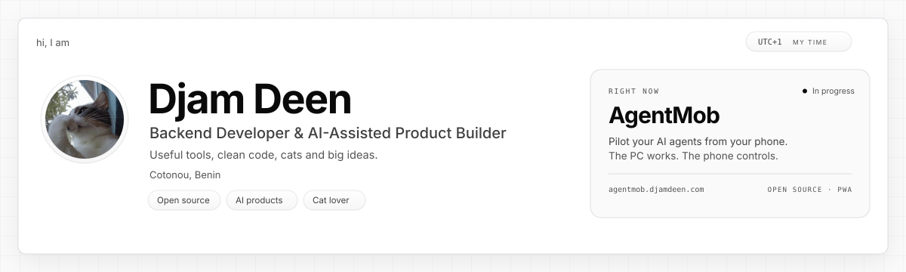

  <picture>
    <source media="(prefers-color-scheme: dark)" srcset="assets/banner-dark.svg">
    <source media="(prefers-color-scheme: light)" srcset="assets/banner-light.svg">
    
  </picture>

  
  
  
  
  

[`en` English](README.md) · [`fr` Français](README.fr.md) · [`es` Español](README.es.md) · [`ar` العربية](README.ar.md) · [`pt` Português](README.pt.md) · [`zh` 简体中文](README.zh.md) · **日本語** · [`ru` Русский](README.ru.md)

## こんにちは 👋 — Djam Deen

**バックエンド開発者 & AIでプロダクトをつくる人** · ベナン、コトヌー

私は **Djamal ALIDOU M.**、でも **Djam Deen** と呼んでください。ベナン出身で、コトヌーに住んでいます。

バックエンド開発を専門とし、アプリ、サイト、API が本当に動き、耐えられ、安全であることを確かめます。見た目がいいだけでは終わりません。そしてバックエンド開発者に対する一般的なイメージとは違い、デザイン面でもとてもきれいなものを作れます 😏。

起業と AI にも情熱を持っていて、日々の仕事で使っています。

仕事は主に自分のプロダクト、オープンソースプロジェクト、ときどき個人向けのプロダクトを中心にしています。

作るためのもの作りはしません。本当の問題に対する解決策を作ります。

## いま取り組んでいること

**現在取り組んでいるプロジェクト。**

<table>
<tr>
<td width="44%" valign="top">
  
</td>
<td width="56%" valign="top">

現在のプロジェクト · <code>進行中</code>

### AgentMob

パソコンで動くコマンドライン AI エージェントを、スマホから操作し、許可を出せるモバイルアプリ。

- **モバイル** — インストール可能な PWA
- **PC** — ローカル npm サーバー + SQLite
- **接続** — 暗号化されたリアルタイム通信
- **シグナリング** — 内容を一切見ない

[AgentMob をオンラインで見る](https://agentmob.djamdeen.com) · [ソースコード](https://github.com/djamdeen10/agentmob-local-server) · [詳細を見る](https://djamdeen.com/ja/projet/agentmob)

</td>
</tr>
</table>

## プロジェクト

**夜を費やしているもの。**

いま夜の大半を費やしているのは AgentMob です。それ以外の深夜のプロトタイプ、小さなツール、オープンソースの実験は GitHub にあります。

[すべてのリポジトリを見る](https://github.com/djamdeen10?tab=repositories) · [プロジェクトページ](https://djamdeen.com/ja/projet)

## いくつかの数字

  
  

## スタック

**問題に合わせて選ぶ。その逆ではない。**

**言語** 
     

**フロントエンド** 
  

**バックエンド & API** 
   

**データ** 
 

**AI** 
 

**ツール & インフラ** 
   

## コードの外では

<table>
<tr>
<td width="50%" valign="top">

**🎧 音楽** <code>Rap / Drill / Pop</code>

いつもヘッドホンを着けています。ラップとドリルでリズムを、少しのポップで気分転換。

</td>
<td width="50%" valign="top">

**⚽ サッカー** <code>FC Barcelona</code>

心はバルセロナ。集団プレー、ビジョン、そしてクラブの進歩する文化への本当の愛着。

</td>
</tr>
<tr>
<td width="50%" valign="top">

**🐱 猫** <code>猫好き 🐾</code>

猫に完全に夢中。家では猫が主導権を握っていて、それでいいと思っています。

</td>
<td width="50%" valign="top">

**🚀 マインドセット** <code>モチベーション</code>

モットーは「大きく夢見て、もっと大きく働く」。新しい挑戦にはいつでも準備万端。

</td>
</tr>
<tr>
<td width="50%" valign="top">

**📺 ドラマ** <code>思考と戦略</code>

頭を働かせ続けるドラマが大好き。複雑な筋書き、練り上げられた戦略、完璧に組み立てられた計画がたまりません。『メンタリスト』から『ペーパー・ハウス』、『スコーピオン』、『ブラックリスト』まで、とんでもない計画を立て、複雑な謎を解き、最後の一分まで頭をひっくり返してくれる作品が好きです。

</td>
<td width="50%" valign="top">

**🤝 ソフトスキル** <code>チームワーク</code>

協力して前に進むのが大好きです。最高のアイデアと最高のプロジェクトはチームで作られると思っています。

</td>
</tr>
</table>

## アイデア、プロジェクト、質問がありますか？

いつでも話しましょう。一番簡単なのはメールをくれることです。

  <a href="mailto:djamdeen10@gmail.com">メールを書く</a> · <a href="https://djamdeen.com/ja">djamdeen.com</a> · <a href="https://github.com/djamdeen10">GitHub</a> · <a href="https://x.com/djamdeen10">X</a>

  <em>「世界を変えられると本気で信じるほどクレイジーな人たちが、実際に世界を変えてきた。」</em> 
  — Steve Jobs

[djamdeen.com](https://djamdeen.com/ja) · コトヌーで ❤️ を込めて

