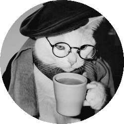
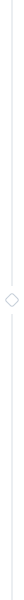

<strong>Hi 👋, I am</strong>

<h3> Djam Deen</h3>

💻&nbsp;Backend&nbsp;Developer&nbsp;&nbsp;&nbsp;·&nbsp;&nbsp;&nbsp;🤖&nbsp;AI-Powered&nbsp;Builder&nbsp;&nbsp;&nbsp;·&nbsp;&nbsp;&nbsp;⚽&nbsp;FC&nbsp;Barcelona&nbsp;Fan&nbsp;&nbsp;&nbsp;·&nbsp;&nbsp;&nbsp;🐱&nbsp;Cats&nbsp;Lover

&nbsp;&nbsp;
&nbsp;&nbsp;
&nbsp;&nbsp;
&nbsp;&nbsp;

**English** · [`fr` Français](README.fr.md) · [`es` Español](README.es.md) · [`ar` العربية](README.ar.md) · [`pt` Português](README.pt.md) · [`zh` 简体中文](README.zh.md) · [`ja` 日本語](README.ja.md) · [`ru` Русский](README.ru.md)

I’m **Djamal ALIDOU M.**, but you can simply call me **Djam Deen**. I’m from Benin and based in Cotonou.

I specialise in backend development: I make sure apps, websites and APIs actually work, hold up and stay secure — not just that they look good. And contrary to the usual backend-dev stereotypes, I can also make things look very clean on the design side 😏.

I’m also passionate about entrepreneurship and AI, which I use every day in my work.

My work mostly revolves around my own products, open-source projects and, occasionally, products for private clients.

I don’t build just for the sake of building: I build solutions to real problems.

## Right now

**What I’m currently working on.**

<table>
<tr>
<td width="44%" valign="top">
  
</td>
<td width="56%" valign="top">

CURRENT PROJECT · <code>In progress</code>

### AgentMob

A mobile app that lets you steer and authorise your command-line AI agents from your phone while they work on your computer.

- **Mobile** — installable PWA
- **PC** — local npm server + SQLite
- **Link** — encrypted real time
- **Signalling** — never sees the content

[View AgentMob online](https://agentmob.djamdeen.com) · [Source code](https://github.com/djamdeen10/agentmob-local-server) · [More details](https://djamdeen.com/projet/agentmob)

</td>
</tr>
</table>

## Projects

**What I spend my nights on.**

AgentMob is the project getting most of my nights right now. The rest — late-night prototypes, small tools and open-source experiments — lives on GitHub.

[See all repositories](https://github.com/djamdeen10?tab=repositories) · [Projects page](https://djamdeen.com/projet)

## Some numbers

  
  

## Stack

**Chosen per problem, not the other way round.**

<table>
<tr>
<td width="47%" valign="top">

**Languages** 
     

**Backend &amp; API** 
   

**AI** 
 

</td>
<td width="6%" align="center" valign="middle"></td>
<td width="47%" valign="top">

**Frontend** 
  

**Data** 
 

**Tools &amp; infra** 
   

</td>
</tr>
</table>

## Beyond the code

<table>
<tr>
<td width="50%" valign="top">

**🎧 Music** <code>Rap / Drill / Pop</code>

Always headphones on. Rap and drill for the rhythm, and a little pop to mix things up.

</td>
<td width="50%" valign="top">

**⚽ Football** <code>FC Barcelona</code>

Barcelona at heart. A real attachment to collective play, vision and the club’s culture of progress.

</td>
</tr>
<tr>
<td width="50%" valign="top">

**🐱 Cats** <code>Cat Lover 🐾</code>

Absolutely crazy about cats. They rule the house, and we love them that way.

</td>
<td width="50%" valign="top">

**🚀 Mindset** <code>Motivation</code>

My motto: “Dream big and work bigger.” Always ready to take on new challenges.

</td>
</tr>
<tr>
<td width="50%" valign="top">

**📺 Series** <code>Thinking &amp; Strategy</code>

A big fan of shows that keep your brain switched on. Complex plots, well-oiled strategies and ultra-tight plans — from The Mentalist to Money Heist, via Scorpion and The Blacklist.

</td>
<td width="50%" valign="top">

**🤝 Soft Skill** <code>Teamwork</code>

I love collaborating and moving forward together. For me, the best ideas and the best projects are built as a team.

</td>
</tr>
</table>

## An idea, a project, a question?

I’m always happy to talk about it. The easiest way is to write to me.

&nbsp;
&nbsp;
&nbsp;
&nbsp;

  <em>“The people who are crazy enough to think they can change the world are the ones who do.”</em> 
  — Steve Jobs

© 2026 Djam Deen — All rights reserved

