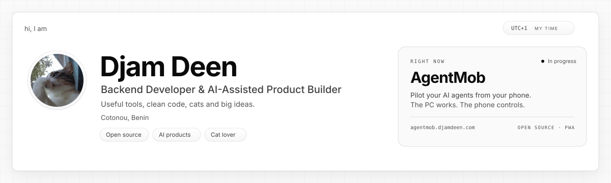

  <picture>
    <source media="(prefers-color-scheme: dark)" srcset="assets/banner-dark.svg">
    <source media="(prefers-color-scheme: light)" srcset="assets/banner-light.svg">
    
  </picture>

  
  
  
  
  

[`en` English](README.md) · [`fr` Français](README.fr.md) · [`es` Español](README.es.md) · [`ar` العربية](README.ar.md) · **Português** · [`zh` 简体中文](README.zh.md) · [`ja` 日本語](README.ja.md) · [`ru` Русский](README.ru.md)

## Olá 👋 — Djam Deen

**Programador backend e criador de produtos com IA** · Cotonou, Benim

Chamo-me **Djamal ALIDOU M.**, mas podes chamar-me simplesmente **Djam Deen**. Sou natural do Benim e vivo em Cotonou.

Especializado em desenvolvimento backend, asseguro-me de que as apps, os sites e as APIs funcionam mesmo, aguentam e são seguros — não apenas que são bonitos. E, ao contrário das ideias feitas sobre os devs backend, também sei fazer coisas muito limpas do lado do design 😏.

Também me apaixonam o empreendedorismo e a IA, que uso todos os dias no meu trabalho.

O meu trabalho gira sobretudo à volta dos meus próprios produtos, de projetos open source e, por vezes, de produtos para particulares.

Não construo só por construir: construo soluções para problemas reais.

## Neste momento

**Aquilo em que estou a trabalhar atualmente.**

<table>
<tr>
<td width="44%" valign="top">
  
</td>
<td width="56%" valign="top">

PROJETO ATUAL · <code>Em curso</code>

### AgentMob

Uma aplicação móvel que permite pilotar e autorizar os teus agentes de IA de linha de comandos a partir do telemóvel, enquanto trabalham no teu computador.

- **Móvel** — PWA instalável
- **PC** — servidor local npm + SQLite
- **Ligação** — tempo real cifrado
- **Sinalização** — nunca vê o conteúdo

[Ver AgentMob online](https://agentmob.djamdeen.com) · [Código-fonte](https://github.com/djamdeen10/agentmob-local-server) · [Mais detalhes](https://djamdeen.com/pt/projet/agentmob)

</td>
</tr>
</table>

## Projetos

**Aquilo em que passo as minhas noites.**

O AgentMob é o projeto que está a ocupar a maioria das minhas noites neste momento. O resto — protótipos noturnos, pequenas ferramentas e experiências open source — vive no GitHub.

[Ver todos os repositórios](https://github.com/djamdeen10?tab=repositories) · [Página de projetos](https://djamdeen.com/pt/projet)

## Alguns números

  
  

## Stack

**Escolhida consoante o problema, não o contrário.**

**Linguagens** 
     

**Frontend** 
  

**Backend e API** 
   

**Dados** 
 

**IA** 
 

**Ferramentas e infraestrutura** 
   

## Fora do código

<table>
<tr>
<td width="50%" valign="top">

**🎧 Música** <code>Rap / Drill / Pop</code>

Sempre com auscultadores. Rap e drill pelo ritmo, e um pouco de pop para variar.

</td>
<td width="50%" valign="top">

**⚽ Futebol** <code>FC Barcelona</code>

Barcelonista de coração. Uma verdadeira ligação ao jogo coletivo, à visão e à cultura de progressão do clube.

</td>
</tr>
<tr>
<td width="50%" valign="top">

**🐱 Gatos** <code>Amante de gatos 🐾</code>

Absolutamente apaixonado por gatos. Mandam em casa, e gostamos deles assim.

</td>
<td width="50%" valign="top">

**🚀 Mentalidade** <code>Motivação</code>

O meu lema: «Sonha em grande e trabalha ainda mais em grande». Sempre pronto para novos desafios.

</td>
</tr>
<tr>
<td width="50%" valign="top">

**📺 Séries** <code>Reflexão e estratégia</code>

Grande fã de séries que obrigam a manter o cérebro ligado. Adoro enredos complexos, estratégias bem oleadas e planos milimétricos. Do Mentalist a La Casa de Papel, passando por Scorpion e The Blacklist, gosto quando se elaboram planos incríveis, se resolvem enigmas complexos e se dá a volta ao cérebro até ao último minuto.

</td>
<td width="50%" valign="top">

**🤝 Competência interpessoal** <code>Trabalho de equipa</code>

Adoro colaborar e avançar em conjunto. Para mim, as melhores ideias e os melhores projetos constroem-se em equipa.

</td>
</tr>
</table>

## Uma ideia, um projeto, uma pergunta?

Estou sempre disponível para falar sobre isso. O mais simples é escreveres-me.

  <a href="mailto:djamdeen10@gmail.com">Escrever-me</a> · <a href="https://djamdeen.com/pt">djamdeen.com</a> · <a href="https://github.com/djamdeen10">GitHub</a> · <a href="https://x.com/djamdeen10">X</a>

  <em>«As pessoas que estão suficientemente loucas para pensar que podem mudar o mundo são as que o fazem.»</em> 
  — Steve Jobs

[djamdeen.com](https://djamdeen.com/pt) · Feito com ❤️ em Cotonou

