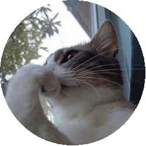
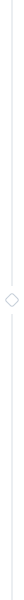

<strong>Привет 👋, я</strong>

<h3> Djam Deen</h3>

💻&nbsp;Бэкенд-разработчик&nbsp;&nbsp;&nbsp;&middot;&nbsp;&nbsp;&nbsp;🤖&nbsp;Создатель&nbsp;продуктов&nbsp;с&nbsp;ИИ&nbsp;&nbsp;&nbsp;&middot;&nbsp;&nbsp;&nbsp;⚽&nbsp;Фанат&nbsp;«Барселоны»&nbsp;&nbsp;&nbsp;&middot;&nbsp;&nbsp;&nbsp;🐱&nbsp;Любитель&nbsp;кошек

&nbsp;&nbsp;
&nbsp;&nbsp;
&nbsp;&nbsp;
&nbsp;&nbsp;

[`en` English](README.md) · [`fr` Français](README.fr.md) · [`es` Español](README.es.md) · [`ar` العربية](README.ar.md) · [`pt` Português](README.pt.md) · [`zh` 简体中文](README.zh.md) · [`ja` 日本語](README.ja.md) · **Русский**

Меня зовут **Djamal ALIDOU M.**, но можно просто **Джам Дин**. Я родом из Бенина и живу в Котону.

Я специализируюсь на бэкенд-разработке и слежу за тем, чтобы приложения, сайты и API действительно работали, выдерживали нагрузку и были безопасными — а не только красивыми. И, вопреки стереотипам о бэкенд-разработчиках, я умею делать очень аккуратные вещи и в дизайне 😏.

Ещё я увлечён предпринимательством и ИИ, которые использую каждый день в работе.

Моя работа в основном строится вокруг моих собственных продуктов, open-source проектов и иногда продуктов для частных клиентов.

Я строю не ради самого строительства: я строю решения реальных проблем.

## Прямо сейчас

**Над чем я сейчас работаю.**

<table>
<tr>
<td width="44%" valign="top">
  
</td>
<td width="56%" valign="top">

ТЕКУЩИЙ ПРОЕКТ · <code>В работе</code>

### AgentMob

Мобильное приложение, которое позволяет управлять ИИ-агентами командной строки и подтверждать их запросы с телефона, пока они работают на компьютере.

- **Мобильное** — устанавливаемая PWA
- **ПК** — локальный npm-сервер + SQLite
- **Связь** — шифрованный реальный времени
- **Сигнализация** — никогда не видит контент

[Открыть AgentMob онлайн](https://agentmob.djamdeen.com) · [Исходный код](https://github.com/djamdeen10/agentmob-local-server) · [Подробнее](https://djamdeen.com/ru/projet/agentmob)

</td>
</tr>
</table>

## Проекты

**То, на что я трачу свои ночи.**

AgentMob — проект, который сейчас занимает большинство моих ночей. Остальное — ночные прототипы, небольшие инструменты и open-source эксперименты — живёт на GitHub.

[Все репозитории](https://github.com/djamdeen10?tab=repositories) · [Страница проектов](https://djamdeen.com/ru/projet)

## Немного цифр

  
  

## Стек

**Выбирается под задачу, а не наоборот.**

<table>
<tr>
<td width="47%" valign="top">

**Языки** 
     

**Бэкенд и API** 
   

**ИИ** 
 

</td>
<td width="6%" align="center" valign="middle"></td>
<td width="47%" valign="top">

**Фронтенд** 
  

**Данные** 
 

**Инструменты и инфраструктура** 
   

</td>
</tr>
</table>

## Вне кода

<table>
<tr>
<td width="50%" valign="top">

**🎧 Музыка** <code>Rap / Drill / Pop</code>

Всегда в наушниках. Рэп и дрилл — за ритм, немного попа — для разнообразия.

</td>
<td width="50%" valign="top">

**⚽ Футбол** <code>FC Barcelona</code>

Барселонец в душе. Настоящая привязанность к коллективной игре, видению и культуре прогресса клуба.

</td>
</tr>
<tr>
<td width="50%" valign="top">

**🐱 Коты** <code>Любитель котов 🐾</code>

Абсолютно влюблён в котов. Они командуют дома, и нам это нравится.

</td>
<td width="50%" valign="top">

**🚀 Настрой** <code>Мотивация</code>

Мой девиз: «Мечтай по-крупному и работай ещё крупнее». Всегда готов к новым вызовам.

</td>
</tr>
<tr>
<td width="50%" valign="top">

**📺 Сериалы** <code>Размышления и стратегия</code>

Большой поклонник сериалов, где нужно держать мозг включённым. Обожаю сложные сценарии, отлаженные стратегии и сверхточные планы. От «Менталиста» до «Бумажного дома», через «Скорпиона» и «Чёрный список»: люблю, когда строят безумные планы, решают сложные загадки и выворачивают мозг до последней минуты.

</td>
<td width="50%" valign="top">

**🤝 Гибкий навык** <code>Командная работа</code>

Обожаю сотрудничать и двигаться вперёд вместе. Для меня лучшие идеи и лучшие проекты создаются в команде.

</td>
</tr>
</table>

## Идея, проект, вопрос?

Я всегда готов обсудить. Проще всего написать мне.

&nbsp;
&nbsp;
&nbsp;
&nbsp;

  <em>«Люди, которые достаточно безумны, чтобы думать, что могут изменить мир, — те, кто это делает.»</em> 
  — Steve Jobs

[djamdeen.com](https://djamdeen.com/ru) · Сделано с ❤️ в Котону

