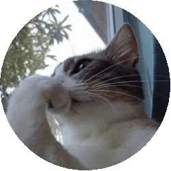
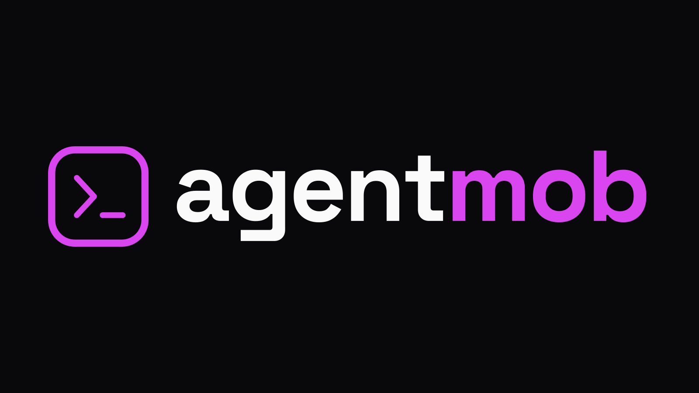

<strong>你好 👋，我是</strong>

<h3> Djam Deen</h3>

💻&nbsp;后端开发者&nbsp;&nbsp;&nbsp;&middot;&nbsp;&nbsp;&nbsp;🤖&nbsp;用&nbsp;AI&nbsp;打造产品的人&nbsp;&nbsp;&nbsp;&middot;&nbsp;&nbsp;&nbsp;⚽&nbsp;巴萨球迷&nbsp;&nbsp;&nbsp;&middot;&nbsp;&nbsp;&nbsp;🐱&nbsp;猫奴

&nbsp;&nbsp;
&nbsp;&nbsp;
&nbsp;&nbsp;
&nbsp;&nbsp;

[`en` English](README.md) · [`fr` Français](README.fr.md) · [`es` Español](README.es.md) · [`ar` العربية](README.ar.md) · [`pt` Português](README.pt.md) · **简体中文** · [`ja` 日本語](README.ja.md) · [`ru` Русский](README.ru.md)

我是 **Djamal ALIDOU M.**，你也可以直接叫我 **Djam Deen**。我来自贝宁，目前住在科托努。

我专注于后端开发，确保应用、网站和 API 真正能用、扛得住、并且安全——而不只是好看。而且和人们对后端开发者的刻板印象相反，我在设计方面也能做出非常干净的东西 😏。

我也热爱创业和 AI，并在日常工作中使用它们。

我的工作主要围绕自己的产品、开源项目，偶尔也为个人客户做产品。

我不是为了造而造：我造的是真实问题的解决方案。

## 正在进行

**我目前在做的事情。**

<table>
<tr>
<td width="44%" valign="top">
  
</td>
<td width="56%" valign="top">

当前项目 · <code>进行中</code>

### AgentMob

一款手机应用，让你在电脑上的命令行 AI 代理工作时，用手机远程操控它们并批准请求。

- **手机** — 可安装 PWA
- **电脑** — 本地 npm 服务器 + SQLite
- **连接** — 加密实时通道
- **信令** — 永远看不到内容

[在线查看 AgentMob](https://agentmob.djamdeen.com) · [源代码](https://github.com/djamdeen10/agentmob-local-server) · [更多细节](https://djamdeen.com/zh/projet/agentmob)

</td>
</tr>
</table>

## 项目

**我熬夜在做的事情。**

AgentMob 是目前占据我大部分夜晚的项目。其余——深夜原型、小工具和开源实验——都在 GitHub 上。

[查看所有仓库](https://github.com/djamdeen10?tab=repositories) · [项目页面](https://djamdeen.com/zh/projet)

## 一些数字

  
  

## 技术栈

**按问题选择，而不是反过来。**

<table>
<tr>
<td width="47%" valign="top">

**语言** 
     

**后端与 API** 
   

**AI** 
 

</td>
<td width="6%" align="center" valign="middle"></td>
<td width="47%" valign="top">

**前端** 
  

**数据** 
 

**工具与基础设施** 
   

</td>
</tr>
</table>

## 代码之外

<table>
<tr>
<td width="50%" valign="top">

**🎧 音乐** <code>Rap / Drill / Pop</code>

耳机永远在头上。说唱和 drill 给我节奏，偶尔来点流行乐换换口味。

</td>
<td width="50%" valign="top">

**⚽ 足球** <code>FC Barcelona</code>

心属巴塞罗那。真正热爱团队足球、视野以及俱乐部不断进步的文化。

</td>
</tr>
<tr>
<td width="50%" valign="top">

**🐱 猫** <code>猫奴 🐾</code>

彻底的爱猫人士。它们在家里说了算，而我们就喜欢这样。

</td>
<td width="50%" valign="top">

**🚀 心态** <code>动力</code>

我的座右铭：「大梦想，更大努力。」随时准备迎接新挑战。

</td>
</tr>
<tr>
<td width="50%" valign="top">

**📺 剧集** <code>思考与策略</code>

非常喜欢让人保持头脑清醒的剧集。我热爱复杂剧情、精密策略和天衣无缝的计划。从《超感神探》到《纸钞屋》，再到《天蝎》和《黑名单》，我喜欢看他们制定疯狂计划、解开复杂谜题，并在最后一分钟颠覆你的大脑。

</td>
<td width="50%" valign="top">

**🤝 软技能** <code>团队协作</code>

我喜欢协作、一起前进。对我来说，最好的想法和最好的项目都是团队做出来的。

</td>
</tr>
</table>

## 一个想法、一个项目、一个问题？

我随时愿意聊。最简单的办法是给我写信。

&nbsp;
&nbsp;
&nbsp;
&nbsp;

  <em>「只有那些疯狂到以为自己能改变世界的人，才能真正改变世界。」</em> 
  — Steve Jobs

[djamdeen.com](https://djamdeen.com/zh) · 用 ❤️ 在科托努制作

